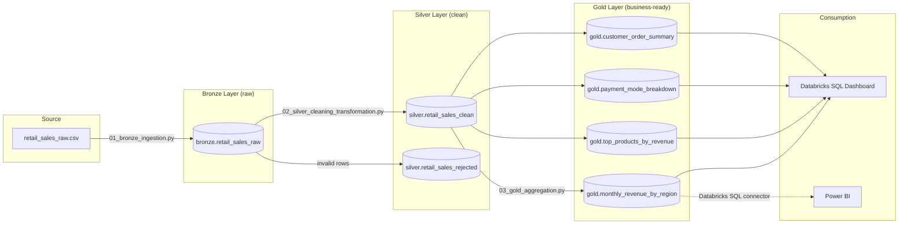

# Architecture

This project implements a **medallion architecture** (Bronze -> Silver ->
Gold), a standard pattern for building reliable data pipelines on Databricks.

## Why medallion architecture?

| Layer  | Purpose                                             | Guarantees                          |
|--------|------------------------------------------------------|--------------------------------------|
| Bronze | Land raw data exactly as received                   | Nothing is ever lost or overwritten before being reviewed |
| Silver | Clean, de-duplicated, correctly typed data           | Every row is either valid or explicitly quarantined |
| Gold   | Pre-aggregated, business-question-shaped tables      | Dashboards query small, fast tables instead of scanning raw data |

## Data quality strategy

Rather than silently dropping bad rows, invalid records are written to
`silver.retail_sales_rejected` with a `_rejected_at` timestamp. This keeps
the pipeline auditable: anyone can query *why* a row was rejected (see
query #6 in `04_analysis_queries.sql`) instead of data quietly
disappearing.

## Idempotency

Every notebook writes with `mode("overwrite")`. This means the entire
pipeline can be re-run end-to-end at any time and will produce the same
result — an important property for scheduled Databricks Jobs, where a
failed run needs to be safely retriable.
